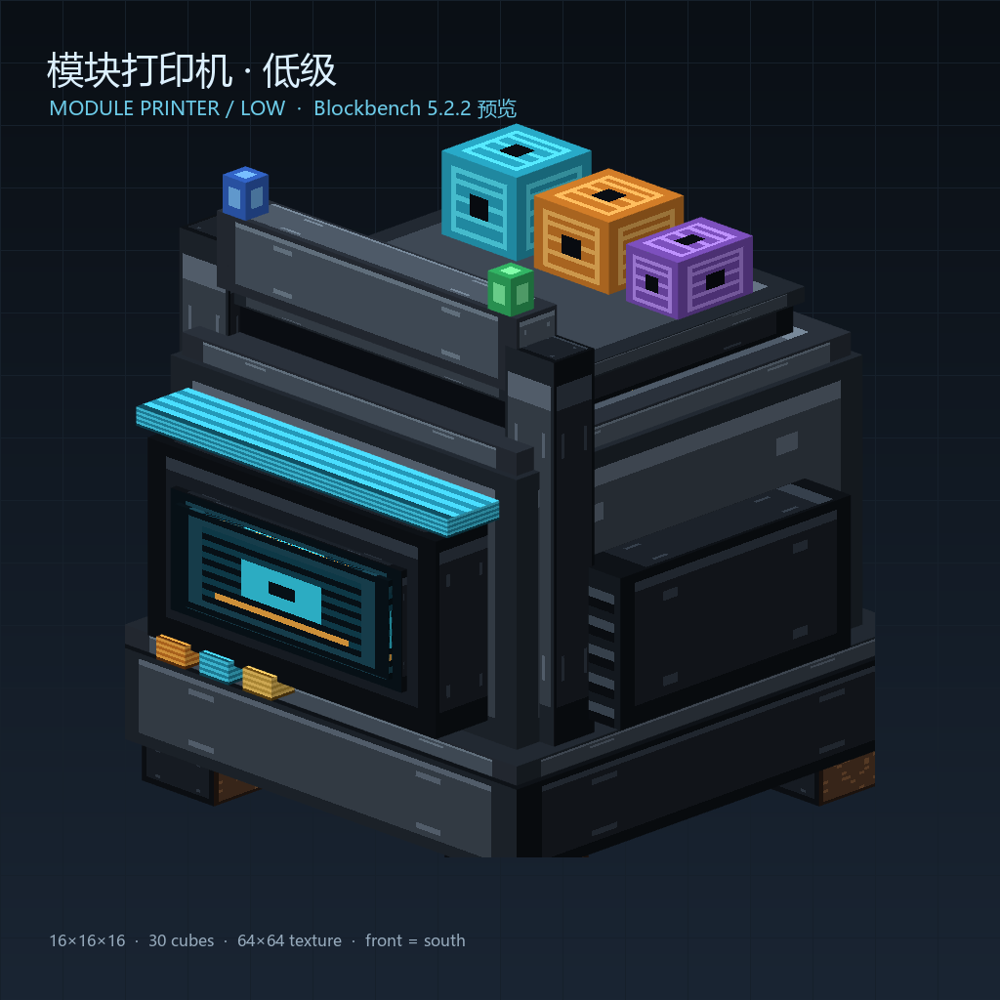

# 模块打印机 · 低级模型 v1

## 文件

| 文件 | 说明 |
|---|---|
| `模块打印机-低级.bbmodel` | Blockbench 5.2.2 工程（Java Block/Item 格式） |
| `模块打印机-低级.png` | 64×64 像素贴图（同时内嵌在 bbmodel 里） |
| `模块打印机-低级-预览.png` | Blockbench 离屏渲染 + 排版预览 |
| `模块打印机-低级-渲染-iso.png` | 原始透明背景渲染 |

## 规格

- 占地：**16×16×16**，一个方块；
- 30 个 cube；
- 64×64 贴图；
- 正面朝 **南（+Z）**，后续接方块朝向；
- 三个顶部模块 = 三个模块仓位；
- 正面：控制屏、三颗按钮、灯带；
- 侧面：散热格栅；
- 后部：龙门架/打印头结构（低级的简化版）；
- 配色：深灰工业机身 + 青色公司色 + 橙/紫模块点缀。

## 预览

## 打开方式

用 Blockbench 5.2.2 打开 `模块打印机-低级.bbmodel`。  
模型是 Java Block/Item 格式，贴图已内嵌，不需要额外找贴图。

## 设计说明

- 低级版先做“一个机身 + 顶部三仓 + 简化龙门”；
- 中级可以加侧面机械臂/更大的模块仓；
- 高级可以加双层龙门/自动换仓/顶部光塔；
- 六家公司后续用同一套几何、换贴图调色，不重复建模。

## 当前状态

**只是模型，还没有接进模组代码。**  
先看外观；确认后我再做：

1. 中级/高级变体；
2. 六家公司配色；
3. 导出 Java block model / GeckoLib；
4. 接方块模型、朝向、破坏掉落；
5. 如果要做动画，再加打印头移动。

## 反馈点

- 整体是不是太方/太矮？
- 顶部三个模块是不是太大？
- 正面青色灯带要不要收窄？
- 屏幕和按钮的位置够不够“模块打印机”的辨识度？
